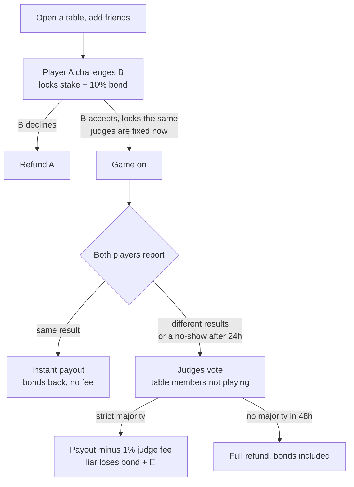

# 🍺 Tavern Wagers

[](https://github.com/bardhojorgo22-beep/wagers/actions/workflows/test.yml)


**Bet on anything with your friends. The money's locked upfront, neutral judges call it, and the winner gets paid automatically. No more "I'll pay you later."**

Built on [Gno.land](https://gno.land) for the Gnome Tavern hackathon.

**Try it in 60 seconds:** open the [web app](https://tavern-wagers.vercel.app). It shows sample data (demo mode) while the testnet package waits for approval: open *Friday Chess Club*, then the disputed *Darts, best of 3* bet and the *Friday poker night* group bet.

**Web app:** https://tavern-wagers.vercel.app · **Realm:** https://onyx.testnets.gno.land/r/g1sgp0eyezdescdtzd32n2vdktazva4nyt9ppmcx/tavernwagers/v5

## The problem

Friendly bets ("I'll beat you at chess", "Arsenal wins Saturday") break down in three ways:

1. **The loser doesn't pay.** "I'll pay you later" turns into never.
2. **Someone has to hold the pot**, and everyone has to trust them.
3. **Arguments about who won.** Two people, two different stories.

## How Tavern Wagers fixes it

| Problem | Fix |
|---|---|
| Loser doesn't pay | Both players lock their stake in the realm **before** the game. Payout is automatic. |
| Someone holds the pot | Nobody does. The realm holds it, and its code is public. |
| Arguments about who won | Everyone else at the table becomes a **judge**. Judges have no money in the bet, so they have no reason to lie. |
| People lie anyway | Each player also locks a **10% honesty bond**. Lose the judges' vote and you lose your bond, plus a permanent 🚩 on the leaderboard. |

The realm takes **no cut**. Every coin that goes in comes back out to players and judges.

## How it works



1. **Open a table** and add your friends with nicknames.
2. **Make a bet** against a friend at the table (hit 🎲 Challenge next to their name). You lock `stake + 10% bond`.
3. Your friend **accepts** by locking the same amount.
4. After the game, **both players report** `a`, `b` or `draw`.
   - **Same report:** paid instantly, both bonds back, no fees.
   - **Different reports:** the bet goes to the judges.
   - The judges are **fixed when the bet is accepted**: every other member of the table at that moment. Both players see the panel before locking money, and nobody can add friends later to swing a vote.
5. **Judges vote.** The moment one result has a strict majority, the bet settles:
   - The pot goes to the winner (or back to both players on a draw), minus a **1% judge fee**.
   - A player whose report lost the vote **forfeits their bond**: half to the honest player, half to the judges.
   - Judges who voted with the majority split the fee and their half of the bond.
6. **No majority within 48 hours?** Anyone can trigger a full refund, bonds included.
7. **No-shows:** if one player reports and the other goes quiet for 24 hours, either player can escalate to the judges.

### The social bits

- **Open challenges:** bet against `anyone` and the first table member to accept plays you.
- **Decline:** the challenged player can turn a bet down; the challenger is refunded.
- **Activity feed** per table: challenges, results, disputes and 🚩 rulings, newest first.
- **Leaderboard honours:** 👑 for the table leader, 🔥 for a 3+ win streak, ⚖️ for trusted judges, 🚩 for lost disputes.
- **Head-to-head records** and a **🔁 Run it back** rematch button on every settled bet.
- **Your move** (web app): one list of every bet at your tables that's waiting on you: accept, report, join or judge.

### Group bets (poker night, tournaments, quizzes)

1v1 isn't enough for a poker night, so Tavern Wagers also does **group bets** for 3 to 20 players.

- Everyone locks the same stake + 10% bond. The game goes live when all invited players have joined.
- The pot pays out by finishing position: **winner takes all**, **60/40**, or **50/30/20** (any split that adds up to 100).
- After the game, **every player reports the top places**. All agree → instant payout. Anyone disagrees → the judges decide.
- **There's no dealer with all the power.** The judges are the table members who are *not* playing, and a result needs a strict majority of them. A bribe has to buy several people, not one.
- **3 judges minimum, by default.** If too many people want to play, the game refuses to start unless the creator explicitly opts in, and then shows a permanent ⚠️ warning. The idea: rotate who sits out and judges each game.
- Any player whose report loses the vote forfeits their bond (half to honest players, half to judges) and gets a 🚩.

### Example

Alice and Bob each lock 5 GNOT + 0.5 GNOT bond. Alice won, but Bob claims he did. Two of three judges vote "Alice won".

| Who | Gets | Why |
|---|---|---|
| Alice | 9.9 GNOT | the pot minus the 1% judge fee |
| Alice | 0.5 GNOT | her bond back |
| Alice | 0.25 GNOT | half of Bob's forfeited bond |
| Judge 1 | 0.175 GNOT | half of (fee + other half of Bob's bond) |
| Judge 2 | 0.175 GNOT | same |
| Bob | 0 | lost the bet and the bond, 🚩 on the leaderboard |

Total paid out: 11 GNOT = exactly what went in.

## Why Gno.land

- **The rules are the code.** Anyone can read the realm's source on-chain before putting money in.
- **The pot is held by the realm**, not a person or a company.
- **Every table renders itself** on gnoweb (leaderboards, bets, votes and payouts) with action links for every step. No separate backend.

## Realm API

| Function | Who | What |
|---|---|---|
| `CreateTable(name, nickname)` | anyone | opens a table, you're the owner |
| `AddMember(tableID, address, nickname)` | table owner | adds a friend |
| `SetNickname(tableID, nickname)` | member | changes your nickname |
| `LeaveTable(tableID)` | member | leaves (not while playing or judging an unfinished bet) |
| `RemoveMember(tableID, address)` | table owner | removes someone with no unfinished bets |
| `CreateBet(tableID, title, opponentName, stake)` + send `stake*1.1` ugnot | member | challenges another member by nickname (or address), or `anyone` for an open challenge |
| `AcceptBet(betID)` + send `stake*1.1` ugnot | player B | accepts the challenge |
| `CancelBet(betID)` | player A | takes back an unaccepted bet |
| `DeclineBet(betID)` | player B | turns the challenge down, A is refunded |
| `Report(betID, "a"/"b"/"draw")` | players | reports the result |
| `Escalate(betID)` | players | sends a no-show to the judges after 24h |
| `Vote(betID, "a"/"b"/"draw")` | judges | votes on a disputed bet |
| `ExpireDispute(betID)` | anyone | refunds everyone if judges miss the 48h deadline |
| `CreatePool(tableID, title, players, stake, payout, acceptFewJudges)` + send `stake*1.1` | member | starts a group bet; `players` = the other players' nicknames, `payout` = `"100"`, `"60,40"`, … |
| `JoinPool(poolID)` + send `stake*1.1` | invited player | locks your stake |
| `CancelPool(poolID)` | creator | calls it off before everyone joined, refunds all |
| `ReportPool(poolID, "Alice,Bob")` | players | reports the paid places, best first |
| `EscalatePool(poolID)` | players | sends no-shows to the judges after 24h |
| `VotePool(poolID, "Alice,Bob")` | judges | votes on a disputed group bet |
| `ExpirePool(poolID)` | anyone | refunds everyone if judges miss the deadline |

Pages: `:` (home), `:table/<id>`, `:bet/<id>`, `:pool/<id>`.

## Deployment

- Network: Gno.land testnet **onyx-1**
- Realm: `gno.land/r/g1sgp0eyezdescdtzd32n2vdktazva4nyt9ppmcx/tavernwagers/v5`
- Page: https://onyx.testnets.gno.land/r/g1sgp0eyezdescdtzd32n2vdktazva4nyt9ppmcx/tavernwagers/v5
- Submitted: (pending; v4 is in block 1391171, tx `MHTx2DCVdZQgrRHA9Oy8qL+mtDgEL7w4CqSCw1k9E48=`)

Onyx parks new packages until its package approver enables them, so the page may show "Not Yet Enabled" for a while after deploying.

## Web app

`web/` is a no-build web app (plain HTML/CSS/JS) on top of the realm: it reads tables and bets through the realm's JSON views (`TablesJSON`, `MyTablesJSON`, `TableJSON`, `BetJSON`, queried with `vm/qeval`) and sends every action through the [Adena](https://adena.app) wallet. Players get a bet form with an opponent picker and the exact amount to lock, one-click accept/report/vote buttons that only show when it's your move, and a head-to-head "versus" view of each bet.

```sh
python3 -m http.server 8080 -d web   # then open http://localhost:8080
```

Pick **Testnet**, **Local (gnodev)** or **Demo** in the top bar. Demo mode uses sample data shaped exactly like the realm's JSON (see `web/demo.js`), so anyone can click through every screen, including a live dispute and an open group bet, without a wallet. The hosted app falls back to it automatically while the testnet package waits for approval. The gnoweb pages work on their own too: every action there is a pre-filled transaction link.

## Run it locally

Requires the Gno toolchain v1.8.0 (`gno`, `gnokey`, `gnodev`).

```sh
gno test -v .                      # unit tests
bash scripts/demo-keys.sh          # creates 5 demo accounts (once)
bash scripts/dev.sh                # starts the local chain; leave it running
# in another terminal:
bash scripts/demo-scenario.sh      # plays a full story: honest bet, a lie caught by judges, an open challenge
# open http://localhost:8888/r/g1sgp0eyezdescdtzd32n2vdktazva4nyt9ppmcx/tavernwagers/v5
```

To play the same story on the real testnet (small stakes) once the package is enabled:

```sh
bash scripts/testnet-demo.sh       # funds the demo accounts from your key, then runs the scenario on onyx-1
```

## Tests

`wagers_test.gno` covers an agreed result, a liar losing their bond, a draw where both players lied, an expired vote, a no-show escalation, cancellation and input validation, a table with no possible judges, nicknames, judges being fixed at accept time, declines, stake limits, open challenges, win streaks, the activity feed, leaving and removing members, JSON views, page rendering, and group bets (agreed winner-takes-all, a disputed 60/40 split with a liar, no-shows, escalation, expiry, validation and cancellation). Every settlement test checks that the coins paid out equal the coins paid in.

## Security notes

The full threat model (attack → mitigation → what's left) and the payout math are in [docs/design.md](docs/design.md).


- **Coins in = coins out.** Every settlement path (agreed, disputed, draw, refund, cancel, decline) is tested to pay out exactly what was locked; rounding dust goes to a named recipient, never stays in the realm.
- **Only real users can lock money.** Every function that reads the sent coins checks `IsUserCall()`, so another realm or a `maketx run` script can't fake a deposit.
- **The sent amount must be exact** (stake + 10% bond), in `ugnot` only.
- **Judges can't be stacked after the fact.** The panel is snapshotted when the bet is accepted (1v1) or when the last player joins (group bet).
- **Players can't judge their own game**, and each judge votes once before a deadline.
- **Bounded work.** Tables cap at 50 members, group bets at 20 players, stakes at 1 billion GNOT (so pots can't overflow), and pages and JSON views show the newest 30 items.
- **Input hygiene.** Titles and names reject control characters, nicknames are limited to letters, numbers, spaces and `- _ .`, and everything rendered to markdown is escaped.

## Limits (honest ones)

- Judges can collude. The bond makes lying expensive, but a table full of bad friends can still out-vote you. Tavern Wagers makes trust between friends fair and permanent; it doesn't replace it.
- The realm can't see the real world. Results come from players and judges, never from an outside data feed.
