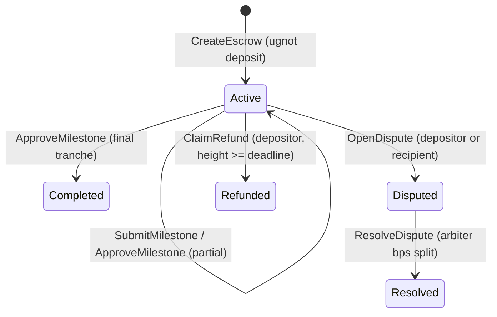

# HearthEscrow

**HearthEscrow** is a trustless milestone-escrow and arbiter-split realm built for Gno.land.

It lets two parties lock `ugnot` behind explicit milestone tranches (in basis points summing to 10,000), release funds incrementally as deliverables are approved, resolve disputes via an optional neutral arbiter with arbitrary percentage splits, and automatically unlock depositor refunds once a target block height passes — all inspectable live through `gnoweb`.

## Why HearthEscrow

Freelance bounties, DAO grants, and guild quests onchain usually fall into two extremes: full upfront trust or heavyweight multi-sig governance. HearthEscrow gives contributors and sponsors a self-contained, auditable escrow primitive in pure Gno with zero external dependencies beyond the standard library and `p/nt/*` utilities.

## Architecture

| File | Responsibility |
| --- | --- |
| `types.gno` | Lifecycle statuses (`active`, `disputed`, `completed`, `resolved`, `refunded`), `Milestone`, `DisputeRecord`, `Escrow`, `Stats`, and safety bounds |
| `errors.gno` | Sentinel error values for every validation, auth, and state-transition guard |
| `escrow.gno` | Core crossing entrypoints, AVL storage (`escrows` + `addressIndex`), accounting invariants, and `chain.Emit` events |
| `render.gno` | `gnoweb` Markdown UI (`/`, `/?status=...`, `/escrow/<id>`, `/address/<addr>`) with dynamic realm path links and copy-pasteable `gnokey` snippets |
| `escrow_test.gno` | Full GnoVM unit test suite covering happy paths, dust-free math, disputes, deadline refunds, auth guards, and `Render()` views |

### Lifecycle State Machine



## Public Crossing API

- `CreateEscrow(cur realm, title string, recipient address, arbiter address, deadlineHeight int64, milestoneTitles string, milestoneBps string) uint64` — Locks the attached `ugnot` deposit into a new escrow. Pass `""` for `arbiter` if no arbiter is needed.
- `SubmitMilestone(cur realm, id uint64, milestoneIndex int, deliverable string)` — Recipient attaches a deliverable URI or note to a pending milestone.
- `ApproveMilestone(cur realm, id uint64, milestoneIndex int) int64` — Depositor approves a milestone (pending or submitted) and releases its `ugnot` tranche. Approving the final unapproved milestone sweeps any integer-division remainder so zero dust is ever trapped.
- `OpenDispute(cur realm, id uint64, reason string)` — Depositor or recipient freezes an active escrow for arbiter review.
- `ResolveDispute(cur realm, id uint64, recipientBps int64, resolutionNote string) (int64, int64)` — Arbiter splits all remaining locked funds between recipient (`recipientBps / 10000`) and depositor (the remainder).
- `ClaimRefund(cur realm, id uint64) int64` — Depositor reclaims remaining locked funds once `runtime.ChainHeight() >= deadlineHeight` (blocked while a dispute is open).

Read-only queries: `GetEscrow(id uint64) *Escrow`, `GetStats() Stats`, `GetAddressEscrowIDs(addr address) []uint64`, and `Render(path string) string`.

## Security Invariants

1. **Direct EOA guard on deposits:** `CreateEscrow` requires `cur.Previous().IsUserCall()` before reading `unsafe.OriginSend()`, preventing indirect `maketx run` or intermediate-realm coin-envelope confusion.
2. **Realm solvency check:** Every deposit verifies the realm's live `ugnot` balance is at least `stats.TotalLocked + amount`.
3. **Checks-Effects-Interactions (CEI):** Every payout and refund updates milestone/escrow status, balances, and protocol stats before calling `banker.SendCoins`.
4. **Overflow-safe & dust-free math:** Deposits are bounded by `math.MaxInt64 / 10000`, milestone basis points must be positive and sum to exactly `10000`, and the final milestone approval sweeps the exact remaining `ugnot`.
5. **Dispute protection:** An open dispute freezes the escrow — neither milestone approvals nor deadline refunds can bypass the arbiter.
6. **Zero-send protection:** `ResolveDispute` skips `SendCoins` for any side whose share is `0` (0 bps or 10,000 bps splits).

## `gnoweb` Routes

- `/` — Protocol dashboard with TVL locked, total released, status counts, filter bar (`All`, `Active`, `Disputed`, `Closed`), and escrow table.
- `/escrow/<id>` — Full escrow detail view with progress bar, party links, milestones table, dispute record, and ready-to-run `gnokey` commands.
- `/address/<addr>` — Per-address portfolio showing counts and volume across Depositor, Recipient, and Arbiter roles.

## Running Tests Locally

Requires the Gno CLI (`gno`) built from [gnolang/gno](https://github.com/gnolang/gno):

```bash
gno test -v .
```

If running against a local checkout of `gnolang/gno`, pass `-root-dir <path-to-gno-repo>`:

```bash
gno test -root-dir <path-to-gno-repo> -v .
```

## Example CLI Flow (`gnokey`)

```bash
# 1. Create a 2-milestone escrow with 1 GNOT (1,000,000 ugnot)
gnokey maketx call -pkgpath "gno.land/r/<your_user>/hearthescrow" \
  -func CreateEscrow -send 1000000ugnot \
  -args "Landing Page Build" -args <recipient_addr> -args <arbiter_addr> -args 500000 \
  -args "Wireframes,Production Build" -args "4000,6000" <depositor_key>

# 2. Recipient submits milestone 0
gnokey maketx call -pkgpath "gno.land/r/<your_user>/hearthescrow" \
  -func SubmitMilestone -args 1 -args 0 -args "https://example.com/wireframes" <recipient_key>

# 3. Depositor approves milestone 0 (releases 400,000 ugnot)
gnokey maketx call -pkgpath "gno.land/r/<your_user>/hearthescrow" \
  -func ApproveMilestone -args 1 -args 0 <depositor_key>
```

## License

MIT — see [LICENSE](./LICENSE).
